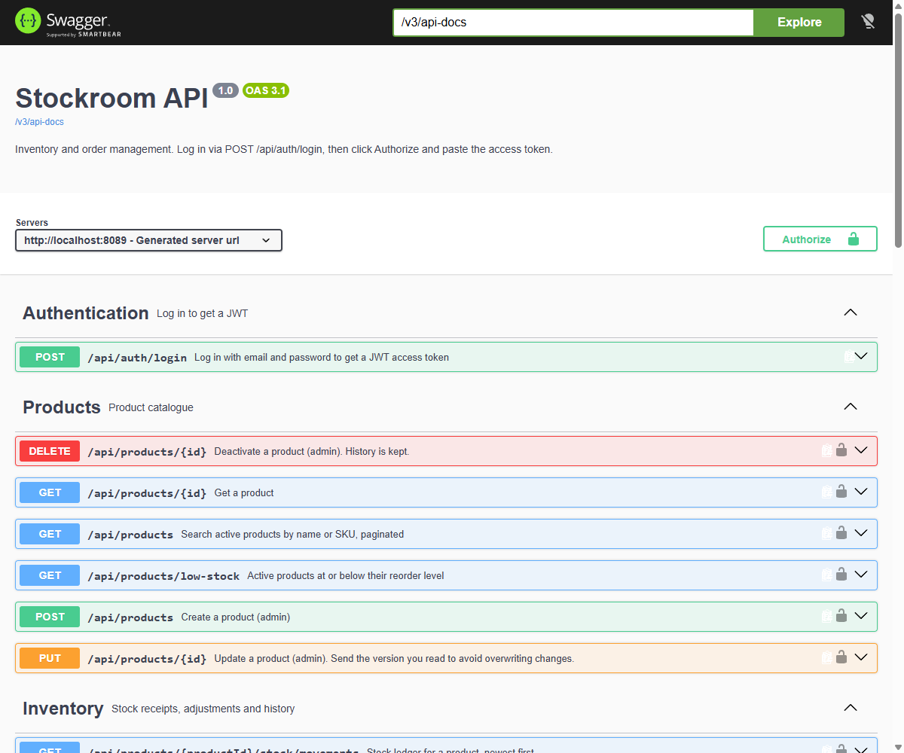
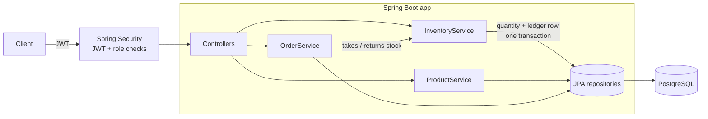

# Stockroom API

[](https://github.com/Pierce-Robinson/stockroom-api/actions/workflows/ci.yml)

A REST API for inventory and order management, built with **Java 21 and Spring Boot 4**. It covers the core of a small ERP: a product catalogue, an auditable stock ledger, and sales orders that reserve stock safely under concurrent load.



## Features

- **Products**: create, search (by name or SKU, paginated), update with optimistic locking, soft delete
- **Stock ledger**: every receipt, adjustment, sale and return is an insert-only movement row, so stock levels are fully auditable
- **Sales orders**: `DRAFT → CONFIRMED → SHIPPED`, or cancelled; prices are captured at order time
- **All-or-nothing stock**: confirming an order takes stock for every line or none, and lists exactly which lines are short
- **No overselling**: product rows are locked in a fixed order during confirmation, proven by a concurrency test
- **Low-stock report**: products at or below their reorder level
- **JWT security**: stateless bearer tokens with `ADMIN` and `STAFF` roles, enforced per endpoint
- **Consistent errors**: every error is an [RFC 9457](https://www.rfc-editor.org/rfc/rfc9457) problem detail with a machine-readable `code`
- **Interactive docs**: OpenAPI 3.1 and Swagger UI

## Tech stack

| | |
| --- | --- |
| Language | Java 21 |
| Framework | Spring Boot 4.1 (Web MVC, Data JPA, Security, Validation, Actuator) |
| Auth | Spring Security OAuth2 resource server, HS256 JWTs, BCrypt |
| Database | PostgreSQL (production), H2 in PostgreSQL mode (zero-setup local runs and tests) |
| Migrations | Flyway |
| Docs | springdoc-openapi (Swagger UI) |
| Testing | JUnit 5, MockMvc, AssertJ: 48 tests |
| Delivery | Docker multi-stage build, Docker Compose, GitHub Actions |

## Architecture



The code is organised **by feature** (`product`, `inventory`, `order`, `user`, `auth`), not by layer, so everything about one concept lives together.

### Design decisions

| Decision | Why |
| --- | --- |
| Stock changes only go through `InventoryService` | The quantity on a product and its ledger rows are written in one transaction, so they can never disagree |
| Pessimistic row locks when confirming orders | Two orders racing for the last units can't both succeed. Rows are locked in id order to avoid deadlocks |
| Optimistic locking (`@Version`) on product edits | Two admins editing the same product get a clear `409` instead of silently overwriting each other |
| Soft delete for products | Old orders and stock history still point at the product |
| Order lines store the unit price | Later price changes don't rewrite past orders |
| A database check constraint on stock | Even a bug in the code can't make stock negative |
| Portable SQL migrations | The same Flyway scripts run on H2 locally and on PostgreSQL in CI and production |

## Running it

**Option 1: no setup** (Java 21 required; uses an in-memory database)

```bash
./mvnw spring-boot:run
```

**Option 2: with PostgreSQL** (Docker required)

```bash
docker compose up --build
```

Then open **http://localhost:8080/swagger-ui.html**, call `POST /api/auth/login`, click **Authorize** and paste the token.

Demo accounts (seeded on first start; for local use only):

| Role | Email | Password |
| --- | --- | --- |
| ADMIN | `admin@stockroom.local` | `Admin123!` |
| STAFF | `staff@stockroom.local` | `Staff123!` |

[`api.http`](api.http) has ready-made example requests.

## Endpoints

| Method | Path | Role | Description |
| --- | --- | --- | --- |
| POST | `/api/auth/login` | public | Log in, get a JWT |
| GET | `/api/products` | any | Search products (paginated) |
| GET | `/api/products/{id}` | any | Get a product |
| GET | `/api/products/low-stock` | any | Products at or below reorder level |
| POST | `/api/products` | ADMIN | Create a product |
| PUT | `/api/products/{id}` | ADMIN | Update a product (send `version`) |
| DELETE | `/api/products/{id}` | ADMIN | Deactivate a product |
| POST | `/api/products/{id}/stock/receipts` | ADMIN, STAFF | Record goods received |
| POST | `/api/products/{id}/stock/adjustments` | ADMIN | Correct stock with a reason |
| GET | `/api/products/{id}/stock/movements` | any | Stock ledger |
| GET | `/api/orders` | ADMIN, STAFF | List orders (filter by `status`) |
| GET | `/api/orders/{id}` | ADMIN, STAFF | Get an order |
| POST | `/api/orders` | ADMIN, STAFF | Create a draft order |
| POST | `/api/orders/{id}/confirm` | ADMIN, STAFF | Confirm and take stock |
| POST | `/api/orders/{id}/ship` | ADMIN, STAFF | Mark as shipped |
| POST | `/api/orders/{id}/cancel` | ADMIN, STAFF | Cancel (restocks if confirmed) |
| GET, POST | `/api/users` | ADMIN | List or create users |
| POST | `/api/users/{id}/disable`, `/enable` | ADMIN | Disable or re-enable a user |

Example error when stock is short:

```json
{
  "type": "about:blank",
  "title": "Business rule violated",
  "status": 409,
  "detail": "Order SO-000012 cannot be confirmed: not enough stock",
  "code": "INSUFFICIENT_STOCK",
  "shortages": [{ "sku": "DRILL-18V", "requested": 3, "available": 1 }]
}
```

## Tests

```bash
./mvnw verify
```

48 tests: end-to-end API tests through the full security stack with real JWTs, unit tests for domain rules, and a concurrency test where four orders race for the same stock. CI runs the suite against **both H2 and a real PostgreSQL database**, and checks that the Docker image builds.

## Configuration

| Variable | Purpose | Default |
| --- | --- | --- |
| `APP_JWT_SECRET` | HS256 signing key (32+ characters). **Set this in production.** | dev-only value |
| `SPRING_PROFILES_ACTIVE` | `postgres` to use PostgreSQL | (H2) |
| `DB_URL`, `DB_USERNAME`, `DB_PASSWORD` | PostgreSQL connection (with the `postgres` profile) | localhost |
| `APP_SEED_ADMIN_PASSWORD`, `APP_SEED_STAFF_PASSWORD` | Passwords for the seeded accounts | demo values |
| `APP_SEED_ENABLED` | Create starter accounts and demo data on an empty database | `true` |

## License

[MIT](LICENSE)
